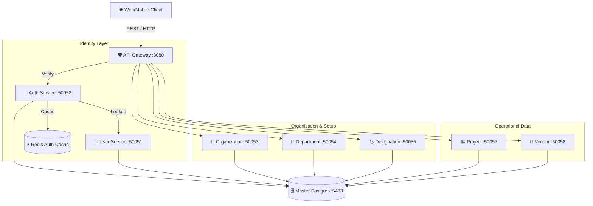

# 🛡️ NHIT Backend: The Core Infrastructure

This repository contains the foundational microservices for the NHIT ecosystem. It is responsible for identity management, organizational hierarchy, administrative data, and the unified API entry point.

---

## 🏗️ Internal Architecture Flow
The Backend repository operates on a **Gateway-to-Service** gRPC pattern. All external traffic enters through the Gateway, which manages authentication before routing to internal services.



---

## 📦 Services Overview

### 1. **API Gateway (:8080)** 🛡️
The brain of the backend. It performs:
- **JWT Middleware**: Validates tokens against `Auth-Service`.
- **Context Injection**: Injects `OrgID`, `TenantID`, and `UserID` into gRPC headers.
- **REST-to-gRPC**: Translates clean HTTP calls into binary gRPC requests.
*(Note: Currently commented out in docker-compose, but architecturally central)*

### 2. **Auth Authority (:50052)** 🔐
Handles the security lifecycle:
- Login/Logout logic.
- Password hashing using BCrypt.
- Session persistence in Redis for high-speed verification.

### 3. **Identity & Org Management**
- **User Service (:50051)**: Role-Based Access Control (RBAC) and profile data.
- **Organization Service (:50053)**: Multi-tenant structural definitions.
- **Department/Designation**: Fine-grained staff categorization.
- **Project Service (:50057)**: Site management, budget tracking, and status.
- **Vendor Service (:50058 gRPC / :8084 HTTP)**: Supplier KYC, banking details, and compliance data. Also serves as specific Gateway for Vendor operations.

---
                                        
## 🛠️ Local Development
To run the core backend, ensure the infrastructure is up first.

### 1. Launch Infra
```bash
docker-compose --profile infra up -d
```

### 2. Run a Service
```bash
# Example: Starting the User Service
cd services/user-service
go run ./cmd/server/main.go
```

---

## 📂 Project Structure
- `api/proto/`: Central repository for all gRPC Protocol Buffers.
- `pkg/`: Shared libraries for Database connection, Middleware, and Logging.
- `services/`: Implementation of each microservice.

---

> [!NOTE]
> This repository provides gRPC endpoints for the **Nhit-Note** (GreenNote) repository to validate projects and vendors.
