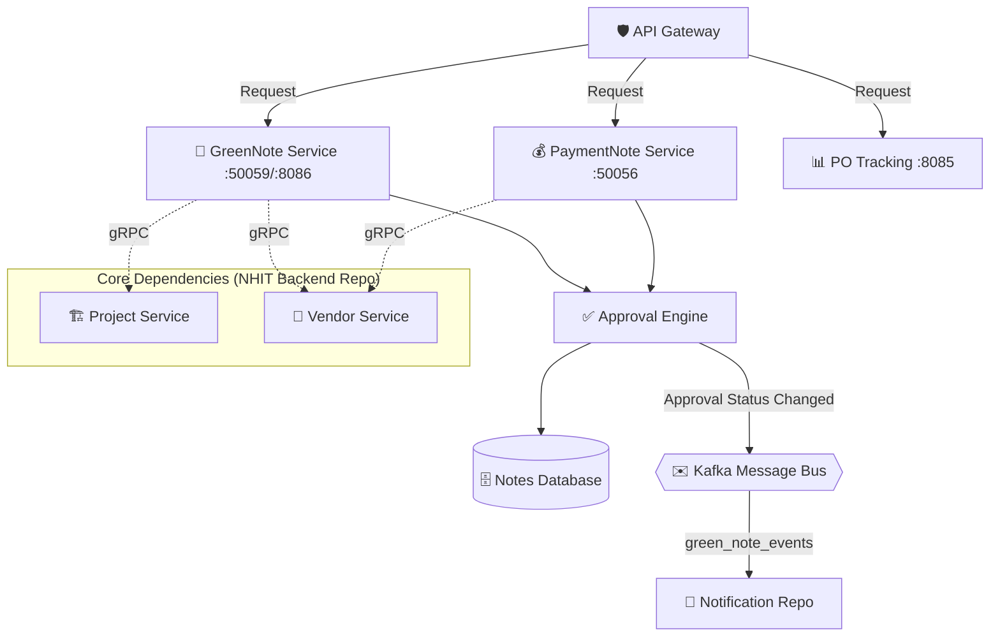

# 📝 Nhit-Note: The Business Logic Engine

This repository is the "Heart" of the Nhit ecosystem. It manages all specialized financial and project workflows, including Green Notes, Payment Notes, and Reimbursements. It is designed to handle complex state transitions and multi-tier approval logic.

---

## ⚡ Workflow Architecture
The services in this repository are **Validators**. They don't just save data; they coordinate with the Base Backend to ensure every note is compliant with organization rules.



---

## ⚙️ Core Modules

### 1. **GreenNote Service** 📄
- **Ports**: `:50059` (gRPC), `:8086` (HTTP)
- **Role**: The primary tool for project-related expenses. Auto-validates budgets with Backend.

### 2. **Payment Note Service** 💰
- **Ports**: `:50056` (gRPC)
- **Role**: Manages payment drafts, TDS calculations, and approval workflows for payments.

### 3. **Payment Service** 💳
- **Ports**: `:50064` (gRPC)
- **Role**: Handles core payment processing logic.

### 4. **PO Tracking Service** 📊
- **Ports**: `:50062` (gRPC), `:8085` (HTTP)
- **Role**: Links notes to Purchase Orders for full auditability and tracks payment history.

### 5. **The Approval Engine** ✅ (Internal Logic / External Service)
- **Expected Port**: `:50060` (gRPC) (Referenced in configs)
- **Role**: Manages voting levels and quorum rules.

---

## 🚦 Integration with Backend
This repository relies heavily on the **NHIT Backend**. To function correctly, it expects:
- **JWT Context**: Authentication headers must be present.
- **gRPC Targets**: The `Project` and `Vendor` services must be reachable via the internal network.

---

## 🛠️ Local Development
1. Ensure `NHIT Backend` is running.
2. Run the specialized service:
```bash
cd services/greennote-service
go run ./cmd/server/main.go
# Service will start on :50059 (gRPC) and :8086 (HTTP)
```

---

> [!TIP]
> **Data Integrity**: Always sync your `.proto` files with the Backend repo to avoid gRPC compatibility issues.
