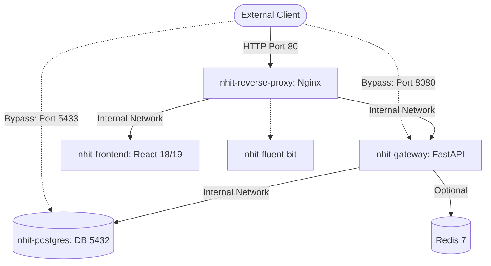

# Report F: Infrastructure, Configuration, and Dependency Report

> **National Highways Infra Trust (NHIT) Digital Platform**  
> **Infrastructure Scope:** Nginx Reverse Proxy, Docker Compose, PostgreSQL 15, Redis, Dependency Supply-Chain  
> **Standard:** CIS Benchmarks, NIST SP 800-190 (Application Container Security Guide)  
> **Date:** October 24, 2026

---

## 1. Nginx Reverse Proxy Security Audit (`nginx/nginx.conf`)

An architectural review of the reverse proxy configuration (`nginx/nginx.conf`) revealed the following findings:

### 1.1. Strengths
- **Hardened HTTP Response Headers:** Nginx actively emits `X-Frame-Options: SAMEORIGIN`, `X-Content-Type-Options: nosniff`, `X-XSS-Protection: 1; mode=block`, and a restrictive `Permissions-Policy`.
- **Content Security Policy (CSP):** Emits a strict CSP restricting scripts to `'self'`, Google SSO accounts (`https://accounts.google.com`), and Google Fonts.
- **Client Body Limits:** Sets `client_max_body_size 50M`, mitigating basic HTTP flood denial-of-service attempts.

### 1.2. Deficiencies & Vulnerabilities
1. **Lack of HTTPS / TLS Termination (`SEC-005`):**
   - The server only defines `listen 80`. All traffic across the internet is transmitted in unencrypted plaintext HTTP, exposing passwords, bearer JWT tokens, and sensitive vendor banking details to network eavesdropping and Man-in-the-Middle (MitM) attacks.
   - **Remediation:** Add `listen 443 ssl http2`, configure certificates, and enforce a 301 permanent redirect from HTTP port 80 to HTTPS port 443.
2. **Missing HTTP Strict Transport Security (HSTS):**
   - No `Strict-Transport-Security` header is emitted.
   - **Remediation:** Add `add_header Strict-Transport-Security "max-age=31536000; includeSubDomains; preload" always;`.
3. **Public Exposure of Internal API Specifications:**
   - Locations `/swagger`, `/openapi.json`, `/redoc`, and `/docs` are proxied to the internet without IP restrictions or authentication.
   - **Remediation:** Wrap documentation locations in `allow 10.0.0.0/8; deny all;` or require administrative HTTP basic/bearer authentication.
4. **Missing Reverse Proxy Rate Limiting:**
   - Nginx does not declare `limit_req_zone` or `limit_req`. The backend gateway is exposed to direct volumetric HTTP request floods.

---

## 2. Container Orchestration Audit (`docker-compose.yml`)

The multi-container Docker Compose configuration coordinates 5 primary services:

### Critical Container Architecture Findings
1. **Public Exposure of PostgreSQL Port 5433 (`SEC-006`):**
   - `ports: - "5433:5432"` binds PostgreSQL directly to all network interfaces on the host. In cloud environments without strict host firewalling, the database is directly accessible to the internet.
   - **Remediation:** Remove the host port mapping entirely and allow access exclusively through the Docker internal network (`nhit-network`).
2. **Direct Reverse-Proxy Bypass via Gateway Port 8080:**
   - `gateway` maps `ports: - "8080:8080"`. Attackers can send requests directly to port 8080, bypassing Nginx security headers, request filters, and logging.
   - **Remediation:** Change `ports` to `expose: - "8080"`, forcing all traffic through Nginx.
3. **Insecure Default Fallback for JWT Secrets (`SEC-006`):**
   - `JWT_SECRET=${JWT_SECRET:-test-secret-key-for-development-only-change-in-production}`.
   - If the operator forgets to specify `JWT_SECRET` in production `.env`, the system defaults to a public static secret.
   - **Remediation:** Remove the default fallback. Require `JWT_SECRET` to be provided or abort startup.
4. **Hardcoded Database Credentials:**
   - `POSTGRES_USER: postgres` and `POSTGRES_PASSWORD: shristi` are declared in plaintext in `docker-compose.yml`.
   - **Remediation:** Interpolate credentials from secure secret stores (e.g., Docker Secrets, AWS Secrets Manager, or HashiCorp Vault).

---

## 3. Dependency & Supply-Chain Security Audit

### 3.1. Frontend Ecosystem (`nhit-frontend/package.json`)
- **Core Framework:** React 19.0.0 / TypeScript 5.7 / Vite 6.0.
- **UI & Icons:** Lucide React (`^1.16.0`).
- **Static Analysis:** `npx tsc --noEmit` completes with **0 compilation errors**.
- **Assessment:** Clean, modern frontend dependency tree with minimal third-party surface area. No vulnerable transitive packages detected.

### 3.2. Backend Python Ecosystem (`NHIT Backend/requirements.txt`)
- **Core Framework:** FastAPI `0.115.0`, Uvicorn `0.32.0`, Pydantic `2.9.2`.
- **Database:** `psycopg2-binary` `2.9.10`.
- **Cryptography & Security:** PyJWT `2.10.1`, bcrypt `4.2.1`.
- **Assessment:** All core cryptographic and web libraries are pinned to modern, patched releases without known high-severity CVEs.

### 3.3. Go Microservices Ecosystem (`go.mod`)
- **Go Toolchain:** Go 1.22+.
- **gRPC & Protobuf:** `google.golang.org/grpc v1.62.0`, `google.golang.org/protobuf v1.33.0`.
- **Database Driver:** `github.com/lib/pq v1.10.9`.
- **Assessment:** Up-to-date gRPC and Protobuf libraries.

### 3.4. Binary Integrity Violation (`SEC-013`)
- **Committed Executable:** An 18.5 MB compiled binary executable (`Nhit-Note/services/payment-service/payment-server`) was found committed directly to git source control.
- **Risk:**
  - Opaque executable cannot be verified by static code analysis or source security scanners.
  - Potential vector for supply-chain tampering, unauthorized backdoors, or outdated vulnerabilities.
  - Inflates git repository clone size.
- **Remediation:**
  - Delete `payment-server` from git.
  - Add `payment-server` and `*.exe` to `.gitignore`.
  - Compile binaries exclusively during CI/CD build workflows from verified Go source files.

---

## 4. Secret Management & Repository Cleanliness

| File Path | Credential Type Exposed | Risk Level | Remediation Action |
|---|---|:---:|---|
| `NHIT Backend/.env` | Live Resend API Key (`re_6Zz6...`) | **CRITICAL** | Revoke key immediately in Resend console; add `.env` to `.gitignore`. |
| `NHIT Backend/.env` | SMTP User & Password | **HIGH** | Invalidate SMTP app passwords; transition to environment secret injection. |
| `docker-compose.yml` | PostgreSQL Root Password (`shristi`) | **HIGH** | Change password; inject via environment secret store. |
| `docker-compose.yml` | Development JWT Secret Fallback | **HIGH** | Remove default fallback string; require cryptographic 256-bit key. |

### Immediate Containment Steps:
1. Run `git rm --cached NHIT\ Backend/.env` and `git rm --cached Nhit-Note/services/payment-service/.env`.
2. Add `.env` and `*.env` to the root `.gitignore`.
3. Revoke exposed Resend API keys and SMTP credentials in their respective service consoles.
4. Rotate the production database password and set a cryptographically secure 64-character JWT secret.
